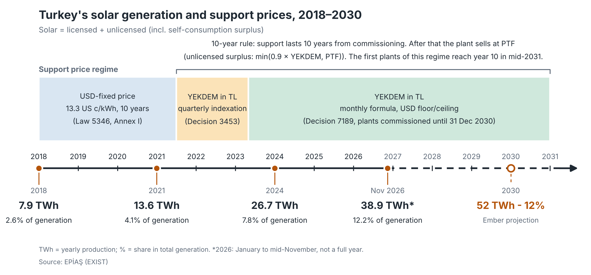
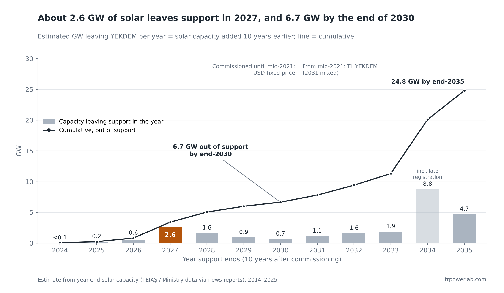
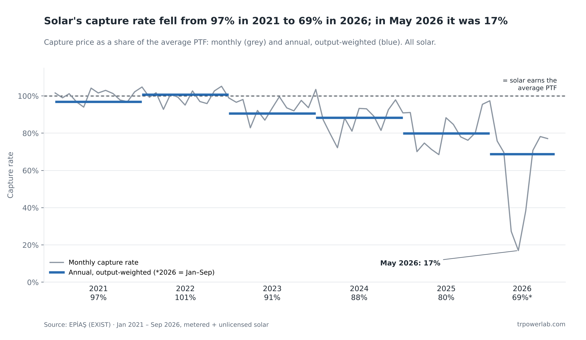
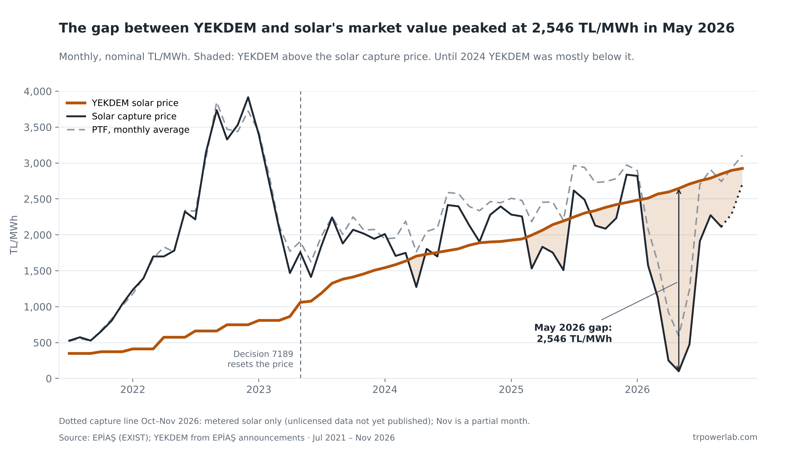

## Summary

- **Solar is cannibalising its own price.** Its capture rate fell from 97% in 2021 to 80% in 2025 and 69% in January–September 2026. In May 2026 it was 17%, and 65% of solar output was produced at a PTF of zero.
- **Scheme doesn't mean endless support for solar.** Each plant gets the feed-in tariff for 10 years. An estimated 2.6 GW leaves support in 2027 and 6.7 GW by the end of 2030; after that, unlicensed surplus earns min(PTF, 0.9 × YEKDEM).
- **The support price has overtaken the market.** The YEKDEM solar price was below solar's market value in most months until 2024. It was above it in seven months of 2025 and in every month of 2026 from February, with the gap peaking at 2,546 TL/MWh in May 2026.
- **Flexibility decides what comes next.** Once plants sell at the midday price, storage, aggregation and hour-by-hour self-consumption decide whether they stay viable and how much balancing costs the system.

## Why solar prices behave differently now

In May 2026, an average MWh of Turkish solar was valued at 17% of the month's average day-ahead price (PTF). Two thirds of all solar output that month (65%) was produced in hours when the PTF was zero.

This is new for the Turkish power market. In 2021 solar output was valued at about the market average: at the hourly day-ahead price, an average MWh of solar would have sold for 97% of the average PTF; this ratio is its capture rate. Most plants were not actually paid this price, because they were paid a feed-in tariff under YEKDEM, Türkiye's renewable support scheme, but it is what they would have earned without this support. By 2025 it was 80%, and from January to September 2026 it was 69%. The more solar the system has, the lower the price in the hours solar produces. This is called **cannibalisation**.

Most Turkish solar does not feel this yet, because its feed-in tariff does not depend on the hourly market. That protection lasts 10 years from each plant's commissioning. The first big group of plants loses it in 2027, and from then on each year more capacity is exposed to the midday price. This article looks at how the feed-in tariff works, how far the midday price has fallen, and why flexibility will decide what happens next.

## How solar investment in Türkiye evolved

Solar capacity grew from 40 MW in 2014 to [24.8 GW at the end of 2025](https://www.donanimhaber.com/turkiye-2025-te-guneste-4-7-gw-lik-yeni-kurulum-gerceklestirdi--200714), most of it unlicensed. Its share of electricity generation rose from under 0.01% in 2014 ([17 GWh](https://www.donanimhaber.com/turkiye-gunes-enerjisinde-641-kat-buyudu-25-gw-a-ulasildi--203595)) to 10.5% in 2025 (37.3 TWh)[<a href="#ref-4">4</a>]. From January to mid-November 2026 it produced 38.9 TWh, 12.2% of all generation.

A **licensed** plant holds a generation licence from EPDK and is built to sell electricity to the market. An **unlicensed** plant is exempt from the licence and from setting up a company[<a href="#ref-5">5</a>]. It is meant to cover the owner's own consumption, its size is capped (today at the contract power of the consumption point it serves), and only the surplus goes to the grid. The exemption exists so that homes, factories and farms can generate their own electricity without the cost and time of licensing.

The build-out came in four waves:

1. **Small unlicensed plants on a USD-fixed price (2014–2020).** Plants of 0.5–1 MW, often grouped next to each other, sold their output at a fixed 13.3 US cents/kWh for 10 years. Capacity reached 3.4 GW in 2017 and 6.7 GW in 2020.
2. **Self-consumption unlicensed plants (from 2019).** The rules began tying unlicensed generation to a consumer, at first with panels on the consumer's own roof or site. Changes in 2022 let the plant sit outside the consumer's distribution region, and then anywhere in the country[<a href="#ref-1">1</a>]. This mattered because land in cities was scarce and expensive for high-consumption factories and buildings, and installations sped up. Ember counts 94% of solar growth from July 2022 to end-2024 as self-consumption plants[<a href="#ref-6">6</a>]. In 2025 alone, [4,175 MW of the 4,696 MW added](https://www.donanimhaber.com/turkiye-2025-te-guneste-4-7-gw-lik-yeni-kurulum-gerceklestirdi--200714) was of this type. Investment incentives (tax reductions, VAT and customs exemptions) add to the case for building[<a href="#ref-2">2</a>].
3. **Licensed and hybrid plants.** Licensed solar is a small share, but how small depends on the source. Official statistics put it at [about 2.5 GW at the end of 2025](https://www.donanimhaber.com/turkiye-2025-te-guneste-4-7-gw-lik-yeni-kurulum-gerceklestirdi--200714). EPDK's licence register (November 2026) shows about 3.2 GW of standalone licensed solar, plus 2.1 GW of solar added to existing wind, hydro or other plants as hybrid capacity. Statistics probably count hybrid solar under the host plant's source.
4. **Storage-integrated plants.** Since 2023, plants that pair solar or wind with storage get their own, higher YEKDEM price, but only for energy they produce and store themselves.

The timeline below puts the build-out next to the support regimes that applied in each period.

{fig-alt="Timeline of Türkiye's solar generation and support regimes, 2018–2030"}

## Feed-in tariff schemes

Türkiye has paid solar a feed-in tariff (FiT)[<a href="#ref-7">7</a>], and the terms depend on the plant type and when it was built. Licensed plants got a USD-fixed price until mid-2021, then a TL price indexed quarterly, and since May 2023 a TL price indexed monthly with a USD floor and ceiling. Unlicensed plants are paid only for the surplus they feed to the grid. The table shows what each type gets during its 10 years of support and after.[<a href="#ref-3">3</a>]

| Plant type | Years 1–10 (support) | After year 10 |
| --- | --- | --- |
| Licensed, commissioned until 30 Jun 2021 | 13.3 US c/kWh, fixed in USD | Market price, no cap |
| Licensed, commissioned 1 Jul 2021 – 31 Dec 2030 | YEKDEM price in TL, indexed (quarterly under 3453, monthly under 7189 since May 2023, with a USD floor and ceiling of 4.95 and 6.05 US c/kWh) | Market price, no cap |
| Unlicensed, capacity granted before 10 May 2019 | Surplus at 13.3 US c/kWh | Surplus at min(PTF, 0.9 × YEKDEM) |
| Unlicensed, capacity granted from 10 May 2019 | Surplus at the retail energy tariff (EPDK) | Surplus at min(PTF, 0.9 × YEKDEM) |

Under Decision 7189[<a href="#ref-8">8</a>] the price is updated every month:

$$
YEKDEM_{GD} = YEKDEM_{OGD} \times \left[0.25\,\frac{PPI_{A-2}}{PPI_{A-3}} + 0.15\,\frac{CPI_{A-2}}{CPI_{A-3}} + 0.30\,\frac{USD_{-1}}{USD_{-2}} + 0.30\,\frac{EUR_{-1}}{EUR_{-2}}\right]
$$

Here YEKDEM_GD is the new month's price and YEKDEM_OGD the previous month's. PPI and CPI are taken from two and three months earlier, and USD and EUR are the central bank's monthly average rates of the previous two months. The new TL price is converted to US cents with the previous month's average rate, clamped between the floor and the ceiling, and converted back.

A worked example from EPİAŞ's announcements[<a href="#ref-9">9</a>]: the solar price was 289.74 kuruş/kWh in October 2026 and 292.49 in November. Neither the floor nor the ceiling bound: at October's average rate of [about 49.4 TL/USD](https://bloomberght.com/dolar-ne-kadar-oldu-14-ekim-2026-dolar-kurunda-son-durum-ne-pkh2-3791309), 292.49 kuruş/kWh is about 5.9 US c/kWh. So the price rose by the bracket in the formula, 1.0095, or 0.95% in a month. Since May 2023 the price has risen from 106.00 to 292.49 kuruş/kWh, a factor of 2.76.

The switch to 7189 was a reset. Under 3453[<a href="#ref-10">10</a>] the quarterly price fell far behind the market during the 2022 price spike: in 2022 it averaged 60 kuruş/kWh (599 TL/MWh) while the PTF averaged 2,506 TL/MWh. In May 2023 the new base jumped to 106.00 kuruş/kWh, from 86.34 a month earlier.

## The 10-year rule

Support lasts 10 years from commissioning, and about 2.6 GW of solar reaches that point in 2027 alone. After year 10, a licensed plant sells at the PTF like any other generator. For unlicensed plants, Presidential Decision 11415[<a href="#ref-11">11</a>] set the rule: surplus (production - consumption) fed to the grid is bought at the lower of 0.9 × the YEKDEM price for the same plant type and the hourly PTF. The region's designated (incumbent) supply company is obliged to buy it, so the plant always has a buyer.

$$
P_t = \min\left(PTF_t,\; 0.9 \times YEKDEM\right)
$$

Here *t* is the hour and YEKDEM is the current monthly price for the same plant type. With the November 2026 solar price of 2,924.9 TL/MWh the cap is 2,632 TL/MWh: an hour with a PTF of 0 pays 0, and an hour with a PTF of 3,400 pays 2,632.

In practice, the unlicensed plant past year 10 gets the market price in every hour it is below 90% of YEKDEM. In hours when the PTF is higher, its price is capped at 90% of YEKDEM (Pₜ = min(PTFₜ, 0.9 × YEKDEM)). In 2026 the solar-weighted PTF was below 90% of YEKDEM in every month from February to October (see the YEKDEM chart below). The plant keeps the downside of the market and gives up the upside.

But how much capacity leaves support each year? There is no public list of solar plants by commissioning date, so the chart below is an estimate: capacity added in year *t* leaves support in year *t* + 10. Two sector figures support it. [EPDK said in May 2026](https://www.sozcu.com.tr/epdk-den-eski-ges-lere-nefes-dagitim-bedelinde-yuzde-68-indirim-p322625) that about 800 plants with a combined 500–550 MW had completed their 10 years. Industry groups [GÜNEŞDER](https://www.ekonomigazetesi.com/sektor-haberleri/gunes-yatirimcisinin-enerjisi-tukeniyor-50655) and GENSED[<a href="#ref-12">12</a>] put the old-regime group at about 7,000 MW. The estimate gives 249 MW by end-2025 and 6,667 MW by end-2030.

{fig-alt="Bar and line chart: estimated solar capacity leaving YEKDEM support each year from 2024 to 2035, with about 2.6 GW in 2027 and a cumulative 6.7 GW by the end of 2030."}

The estimate has limits. Installed capacity is not the same as capacity in YEKDEM: licensed plants choose each year whether to join YEKDEM or sell at the market price, and self-consumption plants only lose support on their surplus. The 2024 additions also include existing plants registered late, so the 2034 bar is too high.

The sector already says the first group is in trouble. In 2025 [GÜNEŞDER said](https://www.ekonomigazetesi.com/sektor-haberleri/gunes-yatirimcisinin-enerjisi-tukeniyor-50655) that many of the roughly 7,000 MW of plants nearing year 10 could not cover even their operating costs after support. How exposed a plant is depends on whether it sells all its output or mostly covers a consumer's own load; the data here do not split the two.

## Capture rate and cannibalisation

Solar's capture rate fell from 97% in 2021 to 80% in 2025 and 69% in January–September 2026. The fall is steepest in spring, when solar output is high and demand is mild.

{fig-alt="Line chart of solar's monthly capture rate from January 2021 to September 2026 with annual output-weighted averages: 97% in 2021, 80% in 2025, 69% in 2026, and a low of 17% in May 2026."}

The **capture price** is what an average MWh of solar would earn at the day-ahead price: the sum of hourly PTF × solar output, divided by solar output. The **capture rate** is the capture price divided by the average PTF of the same period. Because it is a ratio, inflation does not affect it.

The capture price is descriptive only. Most solar plants are paid YEKDEM, not the PTF, so the capture price is not their revenue. It shows what the same output would have earned without support, which is the position of a licensed plant after year 10. An unlicensed plant past year 10 even earns less: it gets min(PTF, 0.9 × YEKDEM) each hour, so for it the capture price is an upper bound.

Spring 2026 was the extreme so far due to record rainfall: hydropower output hit an all-time high, and with solar on top, the monthly PTF in May fell to its lowest level since the day-ahead market opened in 2011[<a href="#ref-13">13</a>]. The capture rate was 27% in April, 17% in May and 38% in June. The share of solar output produced at a PTF of zero was 36% in April, 65% in May and 12% in June. In 2025 that share was 1.7% for the whole year. The capture rate recovers in summer, but the July–August level has fallen every year since 2022: from 98% to 75% in 2026.

## YEKDEM vs capture price vs PTF

In 2026 the YEKDEM solar price was above solar's capture price in every month from February on; the gap peaked at 2,546 TL/MWh in May. That is a recent change. From July 2021 to 2024 the TL support price was below the capture price in most months, often far below; in 2025 it was above it in seven of twelve months. A 3453 plant would have earned more at the PTF than from YEKDEM. The 7189 price is paid directly only to licensed plants commissioned since mid-2021; older plants are on 13.3 US c/kWh and newer unlicensed plants on the retail tariff. It still matters for all of them, because it sets the 0.9 × YEKDEM cap once a plant passes year 10.

{fig-alt="Line chart from July 2021 to November 2026 of the YEKDEM solar price, solar's capture price and the average PTF in TL/MWh. The area where YEKDEM is above the capture price is shaded; the gap peaks at 2,546 TL/MWh in May 2026."}

Two things turned the gap around. Decision 7189 reset the price in May 2023 and has indexed it monthly since, with a USD floor. At the same time, solar pushed its own capture price down. The support gap is now seasonal: large in spring, smaller in summer and winter. In January 2026 it was negative (the capture price was 338 TL/MWh above YEKDEM), and in November 2026 it was 220 TL/MWh (metered solar only, partial month).

This is the gap a plant falls into when it leaves support, and it also sets what support costs. What YEKDEM pays above the market value of the energy is charged to suppliers per MWh they supply: [EPDK set this YEKDEM unit cost at 201–618 TL/MWh for 2026](https://www.bloomberght.com/2026-yili-yekdem-maliyetleri-belirlendi-3765028), and suppliers pass it on to consumers. The lower solar's capture price, the more each supported MWh costs consumers.

## After 2030: why flexibility and asset management matter

By the end of 2030 an estimated 6.7 GW of solar will have left support, and from mid-2031 the first licensed plants on the TL-indexed price follow. Each of them moves from a fixed support price to a price set hour by hour in a market that solar itself is pushing down at midday. Under the official capacity targets, Ember projects 52 TWh of solar in 2030[<a href="#ref-27">27</a>], only about a third more than the 38.9 TWh solar produced from January to mid-November 2026. More solar at the same hours means lower capture rates, not higher.

For these plants, the value of the output depends less on the panel and more on when and how the energy is sold:

- **Storage** moves midday energy to the evening peak. Charging in the midday trough and discharging into the evening ramp flattens the duck curve. That lifts midday prices, so the capture rate rises for all solar, not only for the plant with the battery. The rules already reward it: storage-integrated plants have their own YEKDEM price, and Decision 11415 gives every post-support plant a reason to avoid selling at a zero PTF.
- **Aggregation** lets many small plants sell as one portfolio, take on balancing responsibility together and sell forward instead of only at the day-ahead price. The legal basis is new: EPDK's Aggregation Regulation[<a href="#ref-14">14</a>] took effect on 1 January 2025, and a December 2024 amendment to the Unlicensed Electricity Generation Regulation[<a href="#ref-15">15</a>] lets unlicensed plants past their 10-year guarantee join an aggregator's portfolio. With 49 aggregator licences issued as of November 2026, this could become the main route for old plants to the market, if the rules work in practice.
- **Self-consumption and hybrid plants** keep more value at home. Since May 2026 unlicensed netting is hourly[<a href="#ref-16">16</a>], so a plant earns most when its output matches its consumer's load hour by hour.

The same choices matter for the system. Solar that is shifted or sold flexibly needs less balancing and lowers what support costs. Solar that is simply exposed to the midday price adds to the zero-price hours of spring 2026. Whether solar stays viable after 2030 depends on who manages these plants and how.

## Notes

[1] The 2019 regulation[<a href="#ref-17">17</a>] required an unlicensed plant and its consumer to be in the same distribution region. From late 2020[<a href="#ref-18">18</a>] the plant could sit at a different metering point, but still in that region. In August 2022[<a href="#ref-19">19</a>] the plant was allowed outside the consumer's distribution region, within one supply-company region. From October 2022[<a href="#ref-20">20</a>] plants could serve consumers across supply-company regions, with EPİAŞ doing the netting; new applications were taken from 1 January 2023[<a href="#ref-21">21</a>], and netting across supply-company regions started on 1 July 2023[<a href="#ref-22">22</a>], [<a href="#ref-23">23</a>].

[2] Unlicensed solar gets VAT and customs duty exemptions, plus a corporate tax reduction until a set share of the investment (the contribution rate) is recovered[<a href="#ref-24">24</a>]. Until mid-2025, unlicensed plants above 240 kW got at least the Region 4 incentives, rising to 40% in Region 5 and 50% in Region 6[<a href="#ref-25">25</a>]. Since 2024, panels count as eligible only if their cells are made in Türkiye[<a href="#ref-24">24</a>]. Under the [system introduced in June 2025](https://www.paradergi.com.tr/finans/2025/06/16/yatirim-tesvik-sisteminde-yeni-donem), self-consumption solar for manufacturers is a priority investment with a 30% contribution rate.

[3] Legal basis of the support table: Law 5346, Art. 6, Art. 6/A and Annex I rows d and e[<a href="#ref-7">7</a>]; Decisions 3453[<a href="#ref-10">10</a>], 7189[<a href="#ref-8">8</a>] and 11415[<a href="#ref-11">11</a>]. Indexation: 3453 updated quarterly (26% PPI, 26% CPI, 24% USD, 24% EUR; ceiling 5.10 US c/kWh)[<a href="#ref-26">26</a>]; 7189 updates monthly (25% PPI, 15% CPI, 30% USD, 30% EUR; floor 4.95, ceiling 6.05 US c/kWh). Unlicensed surplus is bought by the incumbent supply company.

## References

[4] Ember, [Türkiye Electricity Review 2026: Wind and solar](https://ember-energy.org/latest-insights/turkiye-electricity-review-2026/wind-and-solar/), 2026.

[5] Elektrik Piyasası Kanunu (Law 6446), Art. 14, Official Gazette 30 Mar 2013, No. 28603.

[6] Ember, [Güneş kapasitesi 2,5 yılda iki katına çıkarak 2025 hedefini aştı](https://ember-energy.org/tr/analizler/gunes-kapasitesi-25-yilda-iki-katina-cikarak-2025-hedefini-asti/), 28 Jan 2025.

[7] Yenilenebilir Enerji Kaynaklarının Elektrik Enerjisi Üretimi Amaçlı Kullanımına İlişkin Kanun (Law 5346), Art. 6, Art. 6/A and Annex I, Official Gazette 18 May 2005, No. 25819.

[8] Presidential Decision No. 7189, Official Gazette 1 May 2023, No. 32177.

[9] EPİAŞ, [announcements on YEKDEM unit prices](https://www.epias.com.tr/?s=yek+belgeli&search-category=elektrik&category=&from=&to=) (49 announcements), Sep 2021 – Nov 2026.

[10] Presidential Decision No. 3453, Official Gazette 30 Jan 2021, No. 31380.

[11] Presidential Decision No. 11415, Official Gazette 13 Jun 2026, No. 33279.

[12] GENSED, [letter to the Ministry of Energy and Natural Resources on unlicensed plants completing ten years](https://gensed.org/wp-content/uploads/2026/05/2025-052-ETKB-10.yilini-dolduran-lisanssizlar-ile-ilgili-onerimiz.pdf), 22 Sep 2025.

[13] Ember, [Renewables save \$750 million in electricity subsidies in Türkiye](https://ember-energy.org/latest-insights/renewables-save-750-million-in-electricity-subsidies-in-turkiye), Jun 2026.

[14] Elektrik Piyasasında Toplayıcılık Faaliyeti Yönetmeliği, Official Gazette 17 Dec 2024, No. 32755.

[15] Elektrik Piyasasında Lisanssız Elektrik Üretim Yönetmeliğinde Değişiklik Yapılmasına Dair Yönetmelik, Official Gazette 17 Dec 2024, No. 32755.

[16] Elektrik Piyasasında Lisanssız Elektrik Üretim Yönetmeliğinde Değişiklik Yapılmasına Dair Yönetmelik, Official Gazette 2 Apr 2026, No. 33212; netting procedures in EPDK Board Decision No. 14531, 30 Apr 2026.

[17] Elektrik Piyasasında Lisanssız Elektrik Üretim Yönetmeliği, Official Gazette 12 May 2019, No. 30772.

[18] Elektrik Piyasası Kanunu ile Bazı Kanunlarda Değişiklik Yapılmasına Dair Kanun (Law 7257), Official Gazette 2 Dec 2020, No. 31322.

[19] Elektrik Piyasasında Lisanssız Elektrik Üretim Yönetmeliğinde Değişiklik Yapılmasına Dair Yönetmelik, Official Gazette 11 Aug 2022, No. 31920.

[20] Elektrik Piyasasında Lisanssız Elektrik Üretim Yönetmeliğinde Değişiklik Yapılmasına Dair Yönetmelik, Official Gazette 1 Oct 2022, No. 31970.

[21] ADM Elektrik, [Güncel Mevzuat Bilgi Notu](https://www.admelektrik.com.tr/storage/uretim-tesisleri-duyurular/January2023/G%C3%BCncel%20Mevzuat%20Bilgi%20Notu.pdf), Jan 2023.

[22] Elektrik Piyasasında Lisanssız Elektrik Üretim Yönetmeliğinde Değişiklik Yapılmasına Dair Yönetmelik, Official Gazette 2 Mar 2023, No. 32120.

[23] EPDK Board Decision No. 11917, 22 Jun 2023.

[24] KPMG, [Teşvik belgeli güneş enerji santrali (GES) yatırımlarında ne durumdayız?](https://kpmgvergi.com/blog/tesvik-belgeli-gunes-enerji-satrali-ges-yatirimlarinda-ne-durumdayiz/1333), 25 Nov 2024.

[25] KPMG, [Yatırım Teşvik Sistemi: regional support rates](https://kpmgvergi.com/Content//Service/Pdf/YatirimTesvikSistemi423092024_052412082821.pdf), 2024.

[26] Mondaq, [New tariff in YEKDEM and local content prices, durations and update principles in Turkey](https://webiis10.mondaq.com/turkey/renewables/1512122/new-tariff-in-yekdem-and-local-content-prices-durations-and-update-principles-in-turkey).

[27] Ember, [Türkiye Elektrik Görünümü 2025: Hedefler](https://ember-energy.org/tr/analizler/turkiye-elektrik-gorunumu-2025/hedefler/), Apr 2025.

## Method and data

**Method.** Solar = metered generation plus unlicensed generation as reported by EPİAŞ. EPİAŞ does not say whether its unlicensed series is total output or surplus; we take it as energy metered at the grid connection, which is total output for standalone plants and for self-consumption plants located away from their consumer, and surplus for rooftop plants on the consumer's own site. For the capture rate this is the right quantity, because energy consumed behind the meter never reaches the market. Unlicensed data arrive about two months late, so October and November 2026 use metered solar only and are left out of the all-solar figures. Capture prices are hourly, aggregated to months weighted by output. Annual capture rates = output-weighted capture price over the hour-weighted average PTF. All prices are nominal TL. YEKDEM prices are EPİAŞ's latest published values[<a href="#ref-9">9</a>]; the 3453 quarterly prices are applied to each month of their quarter.

**Data.** Prices and generation: EPİAŞ (EXIST). Year-end solar capacity: TEİAŞ and Ministry figures as reported in the news.
