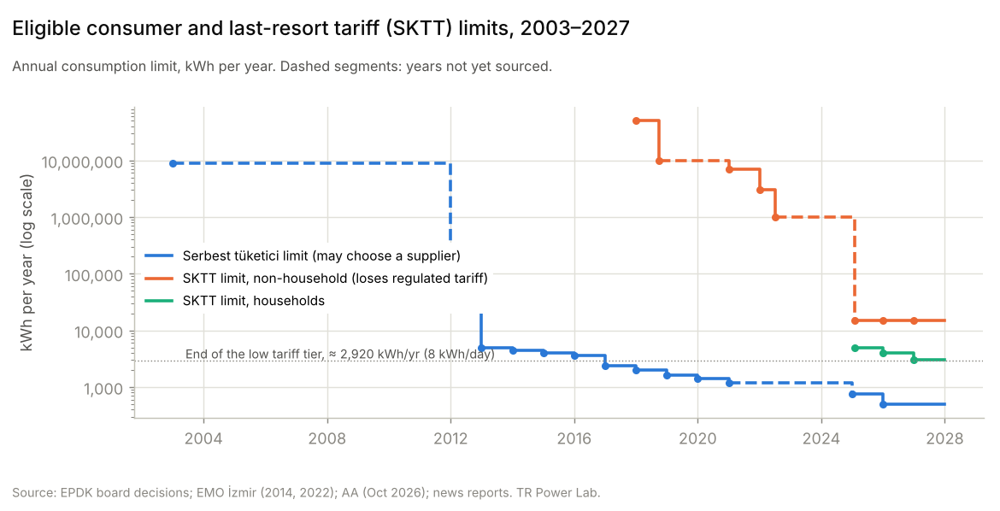
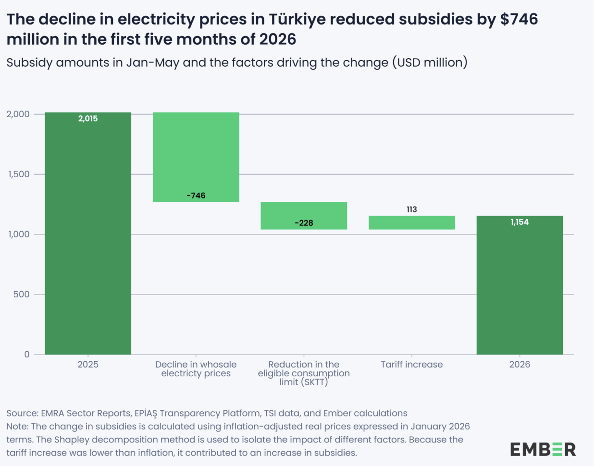
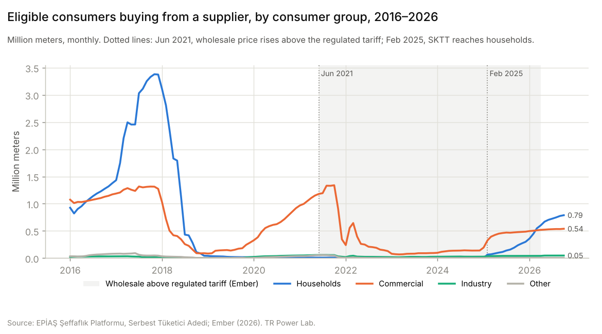
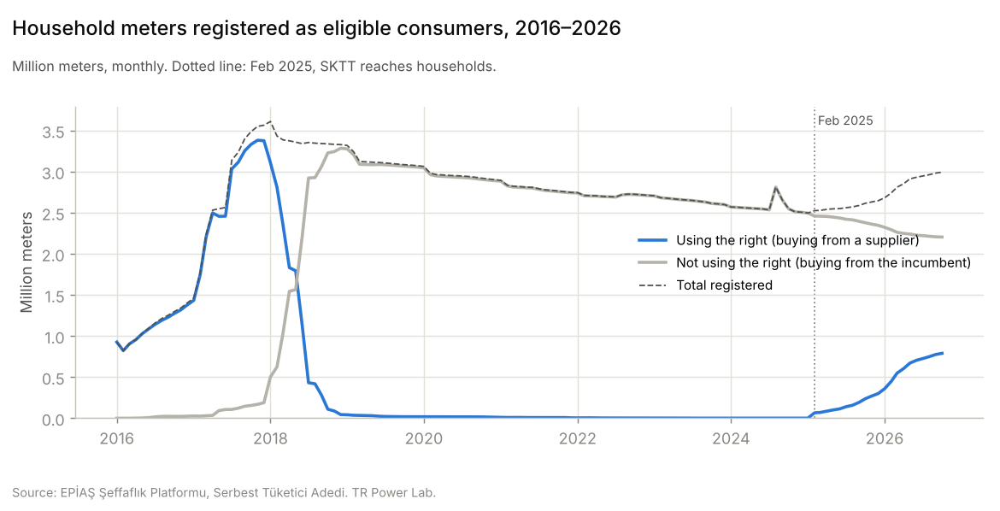
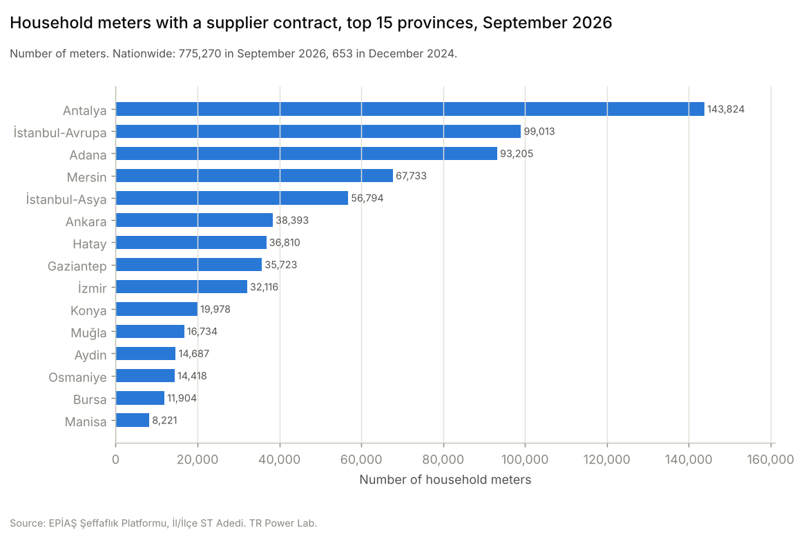
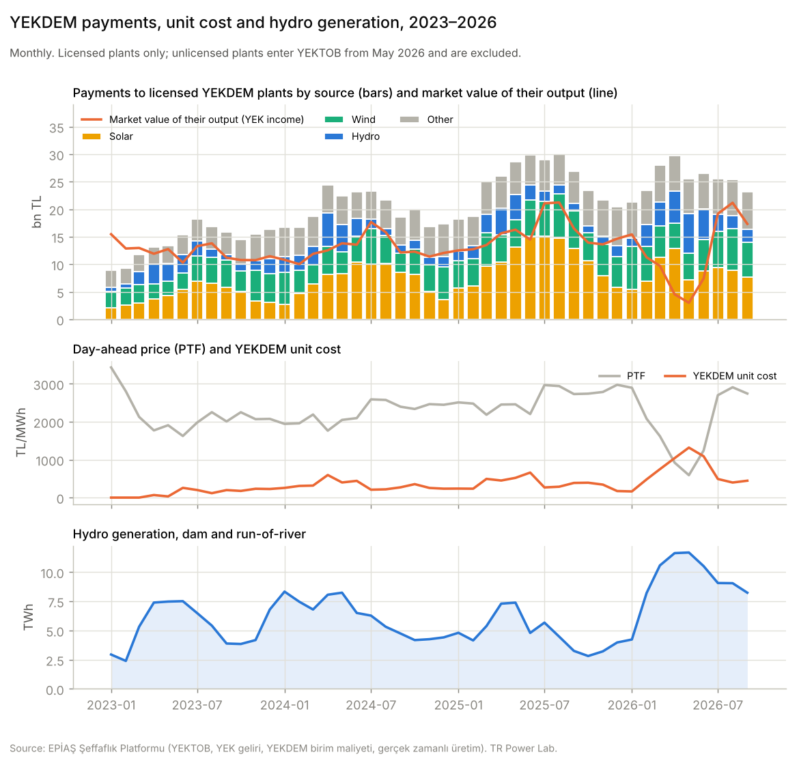

Türkiye is quietly moving from subsidising every household's electricity to subsidising only low consumption, by lowering the consumption threshold for keeping the subsidised tariff: from 5,000 kWh a year in 2025 to 4,000 in 2026 and 3,000 from 2027. The market is not offering households a better deal than the regulated tariff, as expected. So with the new threshold, 14.7% of households, who can no longer benefit from the regulated tariff, will start carrying the market risk instead.

## Good days of heavy rainfall

2026 has been kind to Türkiye's electricity bill. Record rainfall filled the dams and hydro output hit an all-time high. In May, the day-ahead price (PTF) averaged 591 TL/MWh (about \$13/MWh); in real dollar terms, Ember notes, that was the lowest monthly level since the market opened in 2011. Ember calculated that falling wholesale prices cut the state's household electricity subsidy by \$746 million in January–May.

When I read that report, two things stayed with me. First, the saving is a gap closing, not a bill falling: regulated household tariffs do not follow PTF, and on 4 April 2026 they actually rose by 25%. Second, part of the subsidy drop had nothing to do with renewables. It came from pushing heavy-consuming households out of the subsidised tariff altogether.

That second part is the bigger story, and it is the subject of this piece. Using EPİAŞ transparency data, I look at who left the regulated tariff, when, where, and what they pay now.

## Three thresholds, two directions

A Turkish household's electricity price is now set by three different thresholds. They are easy to confuse, so it is worth separating them.

| Threshold | Measured on | What it decides | 2026 value |
|---|---|---|---|
| Stepped tariff (kademe) | daily use, inside each bill | which price you pay on the regulated tariff | 8 kWh/day (~240 kWh in a 30-day bill) |
| Last-resort tariff (SKTT) limit | previous year's total | whether you can stay on the regulated tariff at all | 4,000 kWh/year (5,000 in 2025; 3,000 from 2027) |
| Eligible consumer (serbest tüketici) limit | annual use | whether you are *allowed* to choose a supplier | 500 kWh/year (750 in 2025) |

The first threshold works inside the regulated tariff. The first ~240 kWh of a monthly bill is charged at a low price and everything above it at a higher one.

The other two pull in opposite directions. The eligibility limit gives a household the *right* to leave the regulated tariff, and at 500 kWh a year almost every home has it. However, households prefer to stay in the regulated tariff since almost 50% of the bill is subsidised.

The SKTT limit takes away the *option* to stay. A household loses the regulated tariff when its cumulative use in a calendar year, counted from 1 January, passes 4,000 kWh. The monthly figure of about 333 kWh is only a guide; what counts is the running total, this year or last year. The SKTT then starts on the first day of the third month after the meter reading that crossed the line: a household whose running total passed 4,000 kWh at its 2 June 2026 reading has been billed at the SKTT since 1 September. To return to the regulated tariff, it needs a full calendar year with cumulative use below the next year's limit.

From 1 January 2027, that line drops to 3,000 kWh, about 250 kWh a month. A household above the line that does not pick a supplier is billed at (PTF + YEKDEM) × 1.05, plus distribution and taxes. EPDK states the purpose plainly: the national tariff carries state support, and households above the limit are meant to buy electricity "at real cost".

{fig-alt="Eligible consumer and SKTT limits, 2003–2027"}

One detail matters for what follows. The wires are a regional monopoly: 21 distribution companies, one per region. Retail is not. Each region has one incumbent supplier (görevli tedarik şirketi) that must serve everyone on the regulated tariff and on the SKTT. But an eligible household can sign with any licensed supplier in the country. In practice, the same incumbent group can serve a home in three ways: at the regulated tariff, at the SKTT, or through its own free-market supply company.

## Why no supplier can beat the low tier

A supplier can only compete on the energy part of the bill. Distribution charges and taxes are regulated and identical whoever sells you the electricity. So the comparison that decides whether switching pays is between two energy prices:

- **The regulated energy charge.** Since 4 April 2026, EPDK's tariff table sets it at 0.494 TL/kWh for the low tier and 1.896 TL/kWh for the high tier, before taxes.
- **The market energy cost**, (PTF + YEKDEM) × 1.05. This was about 3.2 TL/kWh in January 2026 and about 2.0 TL/kWh in May 2026, when PTF bottomed out.

Even in May, the low tier was roughly a quarter of what the energy cost on the market. No supplier can offer that. The high tier was beaten only in April and May 2026, if at all. Ember, which adds the previous month's YEKDEM cost, finds the market price fell below it then, after sitting above the residential tariff since June 2021. EPDK, however, bills the SKTT on the same billing period's average PTF and YEKDEM. On that basis the market cost was about 2.0–2.1 TL/kWh, still just above 1.896.

{fig-alt="Market energy cost, regulated household energy charges and supplier switching, 2016–2026"}

This also explains what Ember's \$746 million really is. The subsidy is the gap between the market cost and the tariff, times the subsidised volume. When PTF falls, the gap shrinks and the subsidy shrinks with it, while households keep paying the same bill. Ember's own decomposition shows a second, quieter effect:

- Subsidies fell from \$2,015 million to \$1,154 million (January–May, 2025 vs 2026, real), largely because record rainfall in January–May 2026 lifted hydro output to an all-time high and pushed wholesale prices down.
- \$746 million of that came from lower wholesale prices. This is a real saving for the state, which funds the subsidy largely through EÜAŞ.
- \$228 million came from lowering the SKTT limit. This is not a saving. That cost was moved onto the households pushed out of the tariff.
- \$113 million went the other way, because the April tariff rise lagged inflation.

{fig-alt="Household electricity subsidy, January–May 2025 vs 2026, and the factors behind the change"}

By my rough estimate, the state paid about half of the full cost of subsidised household electricity in early 2025 and about 40% in early 2026. The rest is the tariff that households pay themselves.

## Households switch when they are pushed, not when it pays

EPİAŞ publishes a monthly count of eligible meters that buy from a supplier of their choice, split by consumer group. For households, the series tells a clear story.

{fig-alt="Eligible consumers buying from a supplier, by consumer group, 2016–2026"}

**2020 to mid-2021: the test case.** Before June 2021, the regulated tariff sat above wholesale prices, so a supplier could undercut it. Commercial users noticed: their switched meters grew from about 0.3 million at the end of 2019 to 1.34 million in October 2021. Households stayed between 8,000 and 12,000 meters nationwide, in a country with about 44 million household subscribers. Households respond little to electricity prices: their demand is inelastic in the short run and they rarely compare suppliers, one of the known weaknesses of retail electricity markets. This is called consumer inertia.

**2021 to 2024: the long absence.** Once the tariff fell below the market, even commercial users went back to it. Households all but disappeared: 653 household meters had a supplier in December 2024.

**2025 to 2026: the push.** In February 2025 the SKTT reached households for the first time. It was introduced in 2018 only for the largest industrial users, above 50 GWh a year, and its limit for businesses was cut step by step to 1 GWh in 2022 and 15,000 kWh in 2025 (Figure 1). Switched household meters rose to 300,000 by December 2025 and 789,000 by October 2026. Nothing about the market had become more attractive; for most of 2025 the market energy cost was far above even the high tier. What changed is that the default was taken away.

**What about 2017?** The series shows 3.38 million households with a supplier in November 2017, collapsing to 44,000 a year later. The same dataset reports a second count, meters registered as eligible but not using the right. For households it rose from 0.17 to 3.28 million in exactly those months, and the sum barely moved.

{fig-alt="Household meters registered as eligible consumers, 2016–2026"}

My reading is that these were mostly households moved onto discounted contracts by incumbents' own retail arms in 2016–17, and moved back when those contracts were unwound. That is a different thing from households shopping around. EPİAŞ labels the second count "Serbest Tüketici Hakkını Kullanmayan Tüketici Sayısı": in the words of EPİAŞ's portal guide, meters that have passed the eligibility limit but still buy from their incumbent at EPDK-approved tariffs.

## Who picks a supplier, and who doesn't

EPDK expected about 2.5 million households, roughly 6% of household subscribers, to fall under the 4,000 kWh SKTT limit in 2026. At 3,000 kWh from 2027, it expects 6.5 million, or 14.7% of 44.2 million. By October 2026, 789,000 households had signed with a supplier. If EPDK's estimate holds, about two in three of the households pushed out of the regulated tariff did not pick a supplier and are simply billed at the SKTT price. EPİAŞ's own count of households that hold the right but do not use it, 2.2 million, is a different group: it was already 2.5 million in December 2024, before the SKTT reached households. The households that did switch are the heaviest users. In September 2026, a household that had switched used about 720 kWh on average, twice the 360 kWh of an eligible household that stayed with its incumbent.

The ones who did pick are concentrated where summers are hot, meaning high AC use, in southern cities like Antalya, Adana and Mersin, as well as in the big economic centres Istanbul, Ankara and İzmir.

{fig-alt="Household meters with a supplier contract, top 15 provinces, September 2026"}

Together, the Mediterranean belt holds 46% of the household meters with a supplier contract in September 2026, most of them households that crossed the consumption threshold in 2026. Istanbul's two sides hold 20%. These are the places where air conditioning pushes a normal family's use past 333 kWh a month. Because the limit also counts the current year, one hot summer is enough to cross it mid-year and move to the SKTT that autumn.

Households remain a small part of the free market in energy terms. Eligible consumers bought about 170 TWh from suppliers in 2025, and households accounted for 1.9 TWh of it. This is a story about who is protected, not about the size of the competitive market.

## The YEKDEM catch: PTF fell 76%, the market price only 36%

The households pushed onto market prices do not pay PTF alone. They pay PTF plus the YEKDEM unit cost, the renewable support surcharge that suppliers pass to every consumer they serve. And YEKDEM moves against PTF.

YEKDEM plants are paid fixed, mostly dollar-based prices. What consumers carry is the difference between those payments and what the plants' output earns on the market, spread over all supplied energy. When PTF collapses, the payments barely change, the market income disappears, and the unit cost jumps.

| | May 2025 | May 2026 |
|---|---:|---:|
| PTF (TL/MWh) | 2,458 | 591 |
| YEKDEM unit cost (TL/MWh) | 520 | 1,318 |
| PTF + YEKDEM (TL/MWh) | 2,979 | 1,909 |
| Paid to licensed YEKDEM plants, YEKTOB (bn TL) | 28.7 | 25.6 |
| Market value of their output (bn TL) | 16.3 | 3.0 |

PTF fell 76% year on year, but the price an SKTT household's energy is built on fell about 36%. Hydro's share of YEKTOB rose from 16% to 28% in those months, because much of the surge in hydro output was itself under YEKDEM.

{fig-alt="YEKDEM payments, unit cost and hydro generation, 2023–2026"}

Regulated-tariff households never see this; the YEKDEM cost is inside the tariff and covered by the subsidy. The households above 4,000 kWh pay it explicitly, on every kWh.

**Germany chose the opposite route.** In the middle of the 2022 energy crisis, Germany, the EU's largest electricity market, removed its renewable surcharge (the EEG-Umlage) from every electricity bill from 1 July 2022. The surcharge had been 3.7 ct/kWh, down from 6.5 ct in 2021, and renewable support has since been paid from a federal fund. That saved a four-person household around €300 a year compared with 2021. Germany moved the cost of renewable support from the bill to the budget, for everyone. Türkiye keeps it on the bill and shields households through the tariff, but only below a consumption limit. The cost is concentrated on the households above it.

## Concerns, risks and opportunities

**Consumption is a poor proxy for need.** Targeting the subsidy by how much electricity a household uses is simple to administer, but it does not measure wealth. A family of four in Adana with an electric water heater and two air conditioners can pass 3,000 kWh a year, the 2027 limit, without any luxury. A person living alone in a gas-heated 1+1 in Istanbul may use 1,500 kWh. Both may be equally well off, but only the family loses the subsidy. The households most likely to cross the line are large families and homes that have electrified their heating and cooling, which is the direction climate policy wants them to go. (These consumption figures are illustrative, not measured.)

**The good days will not last.** This year's low prices rest on full dams. Ember points out that the average capacity factor of Turkish hydro has fallen to 26%, 12 points below 1996–2005. In a dry year, gas fills the gap and PTF rises. The households now on market prices will feel it directly, and the subsidy bill for everyone still below 4,000 kWh will grow again. The policy has moved price risk onto the households it pushed out, at a moment when that risk looks smallest.

**The ratchet has already turned again.** On 30 October 2026, EPDK cut the household SKTT limit to 3,000 kWh from 1 January 2027: about 250 kWh a month, or a bill of roughly 820 TL. It expects 6.5 million households, 14.7% of all, to fall above it, against about 2.5 million in 2026. The low tier ends at about 2,920 kWh a year, so the line now sits almost exactly where the low tier stops: a household whose use averages more than about 8.2 kWh a day over the year loses the tariff. Exceeding 3,000 kWh in 2026 already counts. The decision also exempts places of worship, martyrs' families and veterans, and people who depend on electrically powered life support such as dialysis machines and ventilators. That shows targeting by need is possible when the state chooses to do it.

**Switching carries its own risks.** A household that signs with a supplier gives up some protection. If the supplier goes bankrupt, the household falls back to its incumbent at the last-resort tariff and must sign a new contract within 15 working days. Any deposit it paid the supplier is not protected by EPDK or EPİAŞ. EPİAŞ also runs a process to reverse meters added to a supplier's portfolio without a signed bilateral contract. Contract prices are also confidential, so EPDK's online bill calculator cannot check a bilateral bill.

**Inertia is a business opportunity.** If households move only when pushed, most of the ones pushed will not shop around on their own. That leaves room for services that do it for them: comparison and switching platforms, aggregators that negotiate for groups of households, and suppliers that offer fixed prices to customers who no longer want to carry PTF risk. According to EPDK, EPİAŞ has now built its own system where suppliers' offers can be compared and agreements made, accessed through e-Devlet and aimed at households first. It goes further than the existing Serbest Tüketici Portalı, where a registered consumer can see their meters, current supplier and incoming supplier requests, but cannot compare offers. Fixed-price household contracts would also give suppliers a reason to hedge. Today suppliers hedge mostly through bilateral contracts with generators and electricity futures on VİOP, because trading is thin on EPİAŞ's forward market.

## Sources

**Data**

- [EPİAŞ Şeffaflık Platformu](https://seffaflik.epias.com.tr): Serbest Tüketici Adedi, Serbest Tüketici Tüketim Miktarı, İl/İlçe ST Adedi, PTF, YEKDEM Birim Maliyeti, YEKTOB, YEK Geliri, Gerçek Zamanlı Üretim

**Reports and analysis**

- [Ember (June 2026), Renewables save \$750 million in electricity subsidies in Türkiye](https://ember-energy.org/app/uploads/2026/06/ENG-Renewables-save-750-million-in-electricity-subsidies-in-Turkiye.docx.pdf)
- [Anadolu Ajansı (30 October 2026): SKTT household limit 3,000 kWh from 2027](https://www.aa.com.tr/tr/ekonomi/epdk-elektrikte-son-kaynak-tedarik-tarifesi-limitinde-degisiklige-gitti/4106616)
- [Bloomberg HT (30 October 2026): EPDK lowers the SKTT limit to 3,000 kWh](https://www.bloomberght.com/epdk-son-kaynak-tedarik-tarifesinde-limiti-dusurdu-3792931)
- EPİAŞ, Serbest Tüketici Portalı kılavuzu (2021): definitions of using and not using the eligibility right
- [EPDK: SKTT ile ilgili bilinmesi gerekenler](https://www.epdk.gov.tr/Detay/Icerik/16-38/son-kaynak-tedarik-tarifesi-sktt-ile-ilgili-bil): formula, limits, entry and exit (Q7–8), exemptions, purpose
- [EPDK: Mesken abonesi olarak serbest tüketici olmak](https://www.epdk.gov.tr/Detay/Icerik/16-1/mesken-abonesi-olarak-serbest-tuketici-olmak): switching process and consumer rights
- [EPDK: Tedarikçim iflas ederse ne olur?](https://www.epdk.gov.tr/Detay/Icerik/16-25/tedarikcim-iflas-ederse-ne-olur)
- [EPİAŞ: Serbest tüketici kavramı](https://www.epias.com.tr/serbest-tuketici/serbest-tuketici-kavrami/) and [Talep sorunları yönetimi](https://www.epias.com.tr/serbest-tuketici/talep-sorunlari-yonetimi/): registry, switching calendar, unregistered meters, contractless requests
- [EPİAŞ announcement: supplier-selection platform](https://www.epias.com.tr/tum-duyurular/epias-tedarikcilerle-tuketicileri-bulusturan-yeni-bir-platformu-devreye-aliyor/)

**Rules**

- [Bloomberg HT (December 2025): eligible consumer limit 500 kWh](https://www.bloomberght.com/epdk-elektrikte-serbest-tuketici-limitini-dusurdu-3764538)
- [Habertürk (2025): about 2.5 million households affected](https://www.haberturk.com/elektrik-faturalarinda-yeni-donem-984-tl-nin-uzerinde-faturasi-olan-yararlanamayacak-3834110-ekonomi)

**Germany**

- [BMWK: Electricity market of the future](https://www.bundeswirtschaftsministerium.de/Redaktion/EN/Dossier/electricity-market-of-the-future.html) (Germany produces and consumes the most electricity in the EU)
- [Enerdata: Germany will abolish the EEG renewables surcharge in July 2022](https://www.enerdata.net/publications/daily-energy-news/germany-will-abolish-eeg-renewables-surcharge-july-2022.html)
